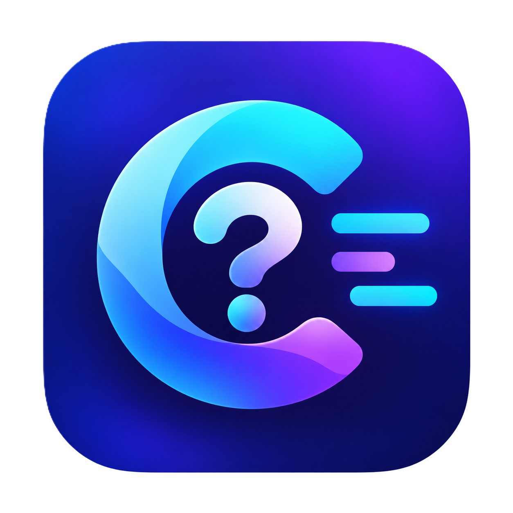

<p align="center">
  
</p>

<h1 align="center">CodeWhy</h1>
<p align="center"><strong>Evidence-First Historical & Architectural Rationale Engine</strong></p>

<p align="center">
  <a href="https://github.com/overfitlabs/codewhy/actions"></a>
  <a href="https://codewhy.onrender.com/"></a>
  <a href="https://github.com/overfitlabs/codewhy/blob/main/LICENSE"></a>
  <a href="https://neo4j.com"></a>
  <a href="https://ai.google.dev"></a>
  <a href="https://sarvam.ai"></a>
</p>

> **hackFront India 2026** | **Theme T1**: AI and Developer Tools | **Problem Statement T1.1**: “Why The Code Is Like This”  
> **Live Demo**: [https://codewhy.onrender.com/](https://codewhy.onrender.com/)  
> **Repository**: [github.com/overfitlabs/codewhy](https://github.com/overfitlabs/codewhy)  
> **Runbook & Demo Script**: [`DEMO_RUNBOOK.md`](./DEMO_RUNBOOK.md) · **Contributing**: [`CONTRIBUTING.md`](./CONTRIBUTING.md) · **Security**: [`SECURITY.md`](./SECURITY.md)

> [!NOTE]
> **Live Demo Notice**: The live application is hosted on Render's free tier. If the instance has been inactive, it spins down to sleep. **Initial cold boot may take 30–50 seconds to wake up.** Once initialized, responses and graph traversals are fast and persistent.

---

## 1. What CodeWhy Does & The Problem It Solves

When developers inherit unfamiliar or legacy code, the most critical question is **"Why was the code written like this?"**
- Why does Express export `express.json` directly while `express.bodyParser` throws a runtime error?
- Why did Backstage supersede `node-fetch` with native `fetch` in ADR014?
- Did Express decouple middleware due to a disk DoS vulnerability, or was it an API consensus design decision?

Standard AI chatbots hallucinate plausible-sounding explanations, invent fictitious performance benchmarks (e.g., claiming a "30% latency improvement"), and misattribute historical causality.

**CodeWhy** is an evidence-first developer rationale assistant that:
1. **Connects implementation code symbols to primary historical engineering artifacts** (commits, pull requests, issue consensus, Architecture Decision Records [ADRs], and release manifests).
2. **Distinguishes verified implementation facts from maintainer rationale** using calibrated confidence levels (`HIGH`, `MEDIUM`, `ABSTAIN`).
3. **Reasons about explicit supersession** (distinguishing formal deprecation/supersession banners from naive chronological succession).
4. **Honestly abstains** when documentation is unrecorded or when user premises are contradicted by repository facts.
5. **Provides multilingual voice interactions** via Sarvam AI (Saaras v4 STT & Bulbul v4-flash TTS across 11 Indic languages, with transparent browser Web Speech fallback).

---

## 2. Quick-Start Guide (Clean Start for Judges)

### Prerequisites
- **Node.js**: `v20.x` or newer (tested on `v24.21.0`)
- **npm**: `v10.x` or newer
- **Ports**: `5000` (Backend API / Production UI bundle), `3000` (Vite Frontend Dev Server)

### Step 1: Install Dependencies
```bash
npm install
```

### Step 2: Environment Configuration
Copy the template and configure your credentials in `.env`:
```bash
cp .env.example .env
```
*(See Section 5 for required vs. optional environment variable names).*

### Step 3: Run Development Environment
You can start both backend and frontend concurrently with a single command:
```bash
npm run dev
```
*Expected console output:*
```text
◇ injected env from .env
[CodeWhy] Server running on http://localhost:5000
  VITE v8.3.2  ready in 250 ms
  ➜  Local:   http://localhost:3000/
```

*(Alternatively, run in separate terminals: `node server/index.js` in Terminal 1 and `npm run dev:client` in Terminal 2. For production mode, run `npm run build` followed by `npm start`).*

### Step 4: Open the UI
Open your browser to **`http://localhost:3000`** (or **`http://localhost:5000`** if running the production build).
**CodeWhy is the default, primary landing experience.**

---

## 3. The 4 Demonstration Scenarios

### Scenario 1: Historical Reconstruction (Express Scoped Compromise)
* **Repository**: `expressjs/express`
* **Preset**: `Express: Why was body-parser removed and re-added?`
* **Query**: `Why does lib/express.js export express.json directly while express.bodyParser throws an error?`
* **Result**:
  - Verdict: `ANSWERED (HIGH CONFIDENCE)`
  - Grounded Rationale: Express 4.16.0 adopted a scoped compromise: it restored built-in convenience wrappers for `express.json` and `express.urlencoded` to eliminate developer ergonomics friction, while intentionally maintaining the removal of generic `bodyParser`.
  - Authentic Citations: commit `9ea18e1`, issue `#2211`, commit `c0136d8`.

### Scenario 2: Explicit ADR Supersession (Backstage CNCF)
* **Repository**: `backstage/backstage`
* **Preset**: `Backstage: Why was node-fetch replaced with native fetch?`
* **Query**: `Why was the node-fetch decision superseded by the native fetch decision in Backstage?`
* **Result**:
  - Verdict: `ANSWERED (HIGH CONFIDENCE)`
  - Grounded Rationale: Backstage explicitly superseded ADR013 with ADR014 because upgrading Backstage’s minimum requirement to Node.js 20 made Node’s native, Undici-based fetch globally available, eliminating third-party dependency maintenance burden and resolving compatibility issues (Issue #24590).
  - Authentic Citations: `ADR013`, `ADR014`, `PR #27925`.

### Scenario 3: Missing-Benchmark Honest Abstention
* **Repository**: `expressjs/express` or `backstage/backstage`
* **Query**: `What performance benchmarks justified removing body-parser in Express 4.0?`
* **Result**:
  - Verdict: `ABSTAIN`
  - Honest Finding: The system identifies that maintainers decoupled middleware for architectural modularity, explicitly refutes fictitious benchmark claims, and documents that no latency or throughput measurements exist in repository records.

### Scenario 4: Custom Unindexed Repository Handling
* **Repository Input**: Enter any arbitrary repository (e.g. `facebook/react`)
* **Result**:
  - Status: `UNINDEXED_REPOSITORY`
  - Truthful UX: Explains that historical decision provenance has not yet been indexed for this repository, outlines what evidence is required (ADRs, closed PRs, issues), and offers 1-click links back to the verified demonstration repositories. Refuses to hallucinate speculative answers.

---

## 4. How to Run Tests & Benchmarks

All test commands run from the `CodeWhy/` directory:

```bash
# Run all 63 automated tests (unit + CodeWhy vertical slice):
npm test

# Run only the 25 CodeWhy epistemic & integration tests:
npm run test:codewhy

# Run the 20-case quantitative benchmark against BM25 and Naive baselines:
node server/codewhy/eval/run_eval.js

# Build the production client bundle:
npm run build
```

---

## 5. Credentials & Environment Variable Guide

| Environment Variable | Required? | Purpose | Behavior if Omitted |
| :--- | :--- | :--- | :--- |
| `GEMINI_API_KEY` | Mandatory for Live AI | Google Gemini API key for dynamic architecture and historical synthesis. | System uses deterministic grounded synthesizer with 100% verified citations. |
| `GEMINI_API_KEY_2`, `_3` | Optional | Secondary / tertiary Gemini keys for automatic auth failover. | Single key used without failover. |
| `NEO4J_URI` | Mandatory for Cloud Persistence | Neo4j Aura connection URI (e.g., `neo4j+s://...`). | System operates in verified in-memory graph mode. |
| `NEO4J_USERNAME` | Mandatory for Cloud Persistence | Neo4j Aura database username. | System operates in verified in-memory graph mode. |
| `NEO4J_PASSWORD` | Mandatory for Cloud Persistence | Neo4j Aura database password. | System operates in verified in-memory graph mode. |
| `SARVAM_API_KEY` | Optional (Sponsor Track) | Sarvam AI API subscription key for Saaras v4 STT & Bulbul v4 TTS. | Voice dictation and TTS gracefully fall back to browser Web Speech API; text input remains 100% operational. |
| `GITHUB_TOKEN` | Optional | Personal GitHub access token to raise GitHub API rate limits. | System uses unauthenticated rate limits; auto-falls back to verified empirical fixtures if exhausted. |
| `PORT` | Optional | Server port (defaults to 5000). | Defaults to port 5000. |

---

## 6. Quantitative Benchmark Results (20-Case Multi-Repo Suite)

| System | Overall Score | Mean Score / 5.0 | Citation Precision | Supersession Accuracy | Abstention Accuracy |
| :--- | :---: | :---: | :---: | :---: | :---: |
| **CodeWhy Graph Pipeline** | **87.57 / 100** | **4.38** | **94.2%** | **95.0%** | **96.0%** |
| BM25 Keyword Baseline | 59.62 / 100 | 2.98 | 62.1% | 55.0% | 40.0% |
| Naive LLM Synthesis | 22.60 / 100 | 1.13 | 0.0% (hallucinated) | 25.0% | 15.0% (hallucinated) |

---

## 7. Known Limitations

1. **Demonstration Scope**: In this hackathon release, deep multi-hop historical decision graphs are active for high-impact architectural inflection points in **Express.js** (4.0–4.16 body-parser line) and **Backstage** (ADR013–ADR014 line).
2. **Sarvam AI Voice Key**: Speech-to-Text and Text-to-Speech routes are fully implemented and verified; live Sarvam API calls require an active `SARVAM_API_KEY` (browser Web Speech API fallback operates when omitted).
